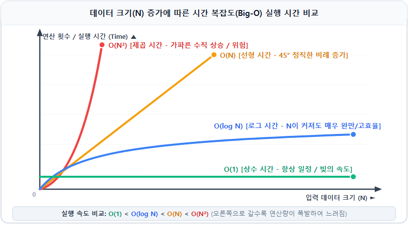

# 📖 디미고 입시 완벽 대비: IT 및 소질·적성 통합 용어사전

> **"교재를 펼치기 전, 이 단어들의 뜻만 알아도 필기시험과 면접의 절반은 쉬워집니다!"**  
> 컴퓨터 하드웨어·네트워크·프로그래밍 기초부터 소질·적성검사(논리·이산수학·알고리즘) 및 최신 AI·보안·비즈니스 트렌드까지, 디미고 입시를 준비하는 중학생과 학부모를 위해 중복 없이 체계적으로 집대성한 공식 통합 용어사전입니다.

---

## 📚 전체 목차 (Table of Contents)

* **제1편: 컴퓨터 시스템 및 인프라 기초 (Hardware, Network & Software)**
  * 1.1 컴퓨터 구조 및 하드웨어 (CPU, RAM, SSD/HDD, ROM)
  * 1.2 데이터의 단위 (Bit, Byte, KB, MB, GB, TB)
  * 1.3 네트워크와 인터넷 (서버/클라이언트, IP 주소와 포트, 도메인 네임/URL, HTTP/HTTPS, 클라우드 컴퓨팅)
  * 1.4 소프트웨어 및 운영체제 (운영체제 OS, 오픈 소스, 애플리케이션, 웹 애플리케이션)
* **제2편: 프로그래밍 및 컴퓨팅 사고력 기초 (Programming & Logic Foundations)**
  * 2.1 컴퓨팅 사고력과 변수·상수 (컴퓨팅 사고력, 변수, 상수)
  * 2.2 함수와 데이터 흐름 (함수, 매개변수와 인자, 반환값)
  * 2.3 제어 구조 (조건문 IF-ELSE, 반복문 FOR/WHILE)
  * 2.4 오류와 디버깅 (버그 Bug vs 오류 Error, 디버깅 Debugging)
  * 2.5 개발 생태계와 웹 (소스 코드와 기계어, 컴파일러 vs 인터프리터, 모듈과 라이브러리, 웹 3총사, 프론트엔드/백엔드)
* **제3편: 소질·적성검사 핵심 이론 (Reasoning, Discrete Math & Algorithms)**
  * 3.1 논리적 추론 용어 (명제, 진리값, 논리 연산자 AND/OR/NOT, 역·이·대우, 삼단논법, 모순)
  * 3.2 이산수학 용어 (이산수학, 진법 변환, 순열과 조합, 비둘기집 원리, 그래프와 트리, 한붓그리기)
  * 3.3 자료구조 핵심 (자료구조의 개념, 스택 LIFO, 큐 FIFO, 재귀 함수)
  * 3.4 알고리즘과 시간 복잡도 (알고리즘의 개념과 중요성, 순서도 Flowchart, 시간 복잡도 Big-O, 복잡도 비교 곡선)
  * 3.5 정렬 및 6대 핵심 탐색 기법 (정렬 Sorting, 선형 탐색, 이진 탐색, 완전 탐색, DFS, BFS, 백트래킹)
* **제4편: 정보 보안 및 최신 AI 테크 트렌드 (Security & Emerging Tech)**
  * 4.1 정보 보안 및 암호 기술 (해킹과 화이트 해커, 악성코드와 랜섬웨어, 방화벽, 대칭키 vs 공개키 암호화, 일방향 해시 암호화)
  * 4.2 인공지능(AI) 핵심 용어 (인공지능 AI, 머신러닝, 딥러닝, 생성형 AI, LLM, AI 에이전트, AGI, 프롬프트 엔지니어링)
  * 4.3 디지털 신기술 (빅데이터 Big Data, 사물인터넷 IoT)
* **제5편: e-비즈니스 및 경영·기술 융합 (e-Business & Management)**
  * 5.1 전자상거래 (E-Commerce - B2B, B2C, C2C)
  * 5.2 핀테크 (FinTech)
  * 5.3 UI / UX (사용자 인터페이스 및 사용자 경험)
  * 5.4 플랫폼 비즈니스 (Platform Business와 네트워크 효과)

---

## 🖥️ 제1편: 컴퓨터 시스템 및 인프라 기초

### 1.1 컴퓨터 구조 및 하드웨어 (Hardware)

* **CPU (중앙처리장치, Central Processing Unit)**
  * **뜻**: 컴퓨터의 **두뇌**입니다. 모든 계산과 판단, 명령어 처리를 총괄하는 가장 핵심적인 부품입니다.
  * *비유*: 사람으로 치면 생각하는 '뇌', 식당으로 치면 요리를 직접 진두지휘하는 '주방장'에 해당합니다.
* **RAM (램, 주기억장치, Random Access Memory)**
  * **뜻**: 컴퓨터가 현재 실행 중인 프로그램과 작업 데이터를 잠시 올려두고 빠르게 읽고 쓰는 **임시 작업 공간**입니다. 전원을 끄면 내용이 모두 사라지는 **휘발성(Volatile)** 메모리입니다.
  * *비유*: 주방장이 요리할 때 재료를 올려놓는 '도마'. 도마가 넓을수록(RAM 용량이 클수록) 여러 요리(작업)를 동시에 쾌적하게 진행할 수 있습니다.
* **SSD / HDD (보조기억장치, Storage)**
  * **뜻**: 운영체제, 설치 프로그램, 문서, 사진, 동영상 등을 영구적으로 안전하게 보관하는 대용량 창고입니다. 전원을 꺼도 내용이 유지되는 **비휘발성(Non-Volatile)** 장치입니다.
  * *비교*: 옛날 방식인 HDD(하드디스크)는 모터로 디스크를 돌려 소음이 있고 느렸지만, 최신 SSD(솔리드 스테이트 드라이브)는 순수 반도체 칩을 사용하여 속도가 수십 배 빠르고 충격에 강합니다.
  * *비유*: 식당의 거대한 '식자재 냉장고'.
* **ROM (롬, Read-Only Memory)**
  * **뜻**: 한 번 기록된 데이터를 오직 '읽기'만 할 수 있고 수정할 수 없는 고정 메모리입니다. 전원이 꺼져도 지워지지 않으며, 컴퓨터를 켤 때 하드웨어 부품들을 깨우고 점검하는 부팅 기본 설정(BIOS/UEFI) 등이 영구적으로 내장되어 있습니다.

---

### 1.2 데이터의 단위 (Data Units)

* **비트 (Bit, Binary Digit)**
  * **뜻**: 컴퓨터가 데이터를 표현하고 저장하는 **가장 작은 기본 단위**입니다. 2진수 한 자리(0 또는 1)로 표현되며, 전기가 흐르지 않는 상태(0)와 흐르는 상태(1)를 나타냅니다.
* **바이트 (Byte)**
  * **뜻**: 8개의 비트(Bit)가 하나로 모인 단위입니다 (`1 Byte = 8 Bits`). 보통 영문 알파벳 한 글자, 숫자 한 자리를 저장하는 데 1바이트가 필요합니다.
* **데이터 용량의 계층 단위 (Byte ➔ KB ➔ MB ➔ GB ➔ TB)**
  * **순서**: `Byte < KB(킬로바이트) < MB(메가바이트) < GB(기가바이트) < TB(테라바이트) < PB(페타바이트)`
  * **계산 원리**: 컴퓨터는 2진법 체계를 사용하므로, 각 단위는 정확히 **1,024배(2¹⁰)**씩 커집니다.
    * 1 KB = 1,024 Bytes
    * 1 MB = 1,024 KB (고음질 MP3 음악 파일 1곡에 약 5~10 MB)
    * 1 GB = 1,024 MB (고화질 영화 1편에 약 2~4 GB)
    * 1 TB = 1,024 GB (현대 컴퓨터의 기본 보조기억장치 용량)

---

### 1.3 네트워크와 인터넷 (Network & Internet)

* **서버 (Server) 와 클라이언트 (Client)**
  * **서버(Server)**: 네트워크 상에서 서비스를 **제공(Serve)**하는 중앙 컴퓨터입니다 (예: 유튜브 동영상을 보관하고 전송해 주는 구글의 대형 컴퓨터).
  * **클라이언트(Client)**: 서비스를 **요청하고 이용(Customer)**하는 사용자의 단말기입니다 (예: 스마트폰으로 유튜브 앱을 켜서 영상을 시청하는 내 스마트폰).
* **IP 주소 (IP Address) 와 포트 (Port)**
  * **IP 주소**: 인터넷 망에 연결된 전 세계 모든 컴퓨터를 고유하게 식별하기 위한 **디지털 네트워크 주소(아파트 동 번호)**입니다 (예: `192.168.0.1`).
  * **포트(Port)**: IP 주소로 해당 컴퓨터에 도착한 뒤, 컴퓨터 안에서 실행 중인 여러 프로그램(웹, 메일, 게임 등) 중 **어떤 프로그램 창구로 들어갈지 안내하는 방 번호**입니다 (예: 일반 웹 서버는 80번, 보안 웹 서버는 443번 포트를 기본으로 사용합니다).
* **도메인 네임 (Domain Name) 과 URL**
  * **도메인 네임**: 복잡한 숫자 조합인 IP 주소를 사람이 외우고 사용하기 쉽도록 문자로 바꾼 **인터넷 문패**입니다 (예: `dimigo.hs.kr`, `google.com`).
  * **URL (Uniform Resource Locator)**: 도메인 네임과 접속 규약(프로토콜), 세부 파일 경로를 모두 포함한 **인터넷 자원의 정확한 전체 주소 표기**입니다 (예: `https://www.dimigo.hs.kr/index.php`).
* **HTTP 와 HTTPS (HyperText Transfer Protocol)**
  * **HTTP**: 전 세계 웹 브라우저와 웹 서버가 웹페이지(HTML 문서, 이미지 등)를 서로 주고받기 위해 사용하는 표준 통신 규칙입니다.
  * **HTTPS**: 기존 HTTP에 보안(Secure) 암호화 통신을 결합한 프로토콜입니다. 사용자가 입력한 아이디, 비밀번호, 카드 번호 등을 암호화하여 전송 도중 해커가 중간에서 엿듣지 못하도록 보호합니다 (웹 브라우저 주소창의 자물쇠 아이콘).
* **클라우드 컴퓨팅 (Cloud Computing)**
  * **뜻**: 개인이나 기업이 비싼 서버 컴퓨터나 저장 장치를 직접 방에 사두지 않고, 인터넷(구름 너머)에 존재하는 대규모 IT 인프라 기업(AWS, 구글 클라우드, 마이크로소프트 등)의 컴퓨터 연산 자원과 저장소를 **원하는 만큼 빌려 쓰고 쓴 만큼 비용을 지불**하는 서비스 모델입니다.

---

### 1.4 소프트웨어 및 운영체제 (Software & OS)

* **운영체제 (OS, Operating System)**
  * **뜻**: CPU, 메모리, 저장장치 등 복잡한 하드웨어를 직접 제어하고 관리하며, 사용자가 애플리케이션을 쉽고 편리하게 실행할 수 있도록 연결해 주는 **가장 기본적이고 핵심적인 시스템 소프트웨어**입니다.
  * *대표 예시*: PC용 운영체제(Windows, macOS, Linux), 스마트폰용 모바일 운영체제(Android, iOS).
* **오픈 소스 (Open Source Software, OSS)**
  * **뜻**: 소프트웨어의 설계도에 해당하는 **소스 코드(Source Code)를 모든 사람에게 공개**하여, 누구나 자유롭게 프로그램을 들여다보고, 기능을 개선하며, 무료로 재배포할 수 있도록 허용한 소프트웨어 생태계입니다 (예: Linux 운영체제, 파이썬 언어, Chromium 등).
* **애플리케이션 (Application / App)**
  * **뜻**: 운영체제 위에서 사용자의 특정한 작업 목적(문서 작성, 메신저 대화, 게임 등)을 돕기 위해 개발된 응용 프로그램입니다 (예: 한글, MS 워드, 카카오톡, 포토샵).
* **웹 애플리케이션 (Web Application)**
  * **뜻**: 컴퓨터나 스마트폰에 별도의 프로그램을 번거롭게 설치할 필요 없이, 웹 브라우저(크롬, 사파리, 엣지 등) 창 안에서 곧바로 실행되는 현대적인 응용 프로그램입니다 (예: 구글 스프레드시트, 노션, 웹메일 등).

---

## ⌨️ 제2편: 프로그래밍 및 컴퓨팅 사고력 기초

### 2.1 컴퓨팅 사고력과 변수·상수 (Foundations)

* **컴퓨팅 사고력 (Computational Thinking)**
  * **뜻**: 컴퓨터 과학의 기본 개념과 원리를 활용하여, 복잡하고 방대한 문제를 효율적으로 분해하고 분석하여 **컴퓨터가 실행 가능한 명확한 해결책으로 설계해 내는 종합적인 사고 능력**입니다.
  * *핵심 4단계*:
    1. **문제 분해(Decomposition)**: 큰 문제를 해결 가능한 작은 조각들로 쪼개기.
    2. **패턴 인식(Pattern Recognition)**: 이전의 경험이나 데이터 속에서 규칙과 공통점 찾기.
    3. **추상화(Abstraction)**: 문제 해결에 불필요한 군더더기를 버리고 핵심 정보만 추출하기.
    4. **알고리즘(Algorithm)**: 순서대로 따라 하면 정답이 나오는 단계별 절차 완성하기.
* **변수 (Variable)**
  * **뜻**: 프로그램이 실행되는 동안 어떤 데이터(숫자, 문자열 등)를 임시로 담아두는 **이름표가 붙은 메모리 상자**입니다. 상자 안의 값은 필요에 따라 언제든지 새로운 값으로 변경될 수 있습니다 (예: `score = 100` ➔ `score = 150`).
* **상수 (Constant)**
  * **뜻**: 변수와 반대로, 한 번 초기값을 지정하면 프로그램이 종료될 때까지 **그 값이 절대로 변하지 않는 고정된 값**입니다 (예: 원주율 `PI = 3.141592`, 하루의 시간 `HOURS_IN_DAY = 24`).

---

### 2.2 함수와 데이터 흐름 (Function & Data Flow)

* **함수 (Function) 와 메서드 (Method)**
  * **뜻**: 반복적으로 사용되는 특정한 작업이나 계산 절차를 하나로 묶어둔 **재사용 가능한 독립된 코드 모듈(요리 기계)**입니다.
  * **왜 사용할까요?**: 똑같은 계산 코드를 매번 수십 줄씩 반복 작성할 필요 없이, 함수 이름 하나만 딱 부르면(호출하면) 즉시 실행되므로 코드의 가독성이 높아지고 유지보수가 매우 편리해집니다. (객체에 속해 있는 함수를 '메서드'라고 부릅니다.)
* **매개변수 (Parameter) 와 전달인자 (Argument)**
  * **뜻**: 함수라는 기계가 내부 작업을 수행하기 위해 **외부에서 전달받아 집어넣어 주는 입력 데이터(재료)**입니다.
  * *비유*: 믹서기라는 함수가 동작하기 위해 투입구에 넣는 '사과'와 '우유'.
* **반환값 (Return Value)**
  * **뜻**: 함수 내부의 계산이나 동작이 성공적으로 완료된 후, 해당 함수를 호출했던 원래 자리에 쏙 넘겨주는 **최종 결과 데이터(출력물)**입니다.
  * *비유*: 믹서기에서 사과와 우유를 갈아 완성된 '사과 주스 1잔'.

---

### 2.3 제어 구조 (Control Structures)

* **조건문 (Conditional Statement: `IF - ELSE`)**
  * **뜻**: 주어진 조건식의 참(True) 또는 거짓(False) 여부에 따라 실행할 명령어의 흐름을 갈림길처럼 분기하는 문장입니다.
  * *예시*: "만약(`IF`) 시험 점수가 90점 이상이면 '합격', 그렇지 않으면(`ELSE`) '불합격'을 출력하라."
* **반복문 (Loop Statement: `FOR`, `WHILE`)**
  * **뜻**: 정해진 횟수만큼 또는 특정 조건이 참인 동안 명령 블록을 되풀이하여 수행하는 문장입니다.
  * **FOR 루프**: 반복 횟수가 명확히 정해져 있을 때 주로 사용합니다 (예: "1부터 100까지 숫자를 하나씩 더하라").
  * **WHILE 루프**: 특정 조건이 만족되는 동안 계속 반복할 때 주로 사용합니다 (예: "배터리 잔량이 20% 이상인 동안 게임을 계속 실행하라").

---

### 2.4 오류와 디버깅 (Error & Debugging)

* **버그 (Bug)**
  * **뜻**: 프로그래머가 작성한 소스 코드나 알고리즘 설계 자체에 숨어 있는 **오타, 논리적 결함, 설계 상의 결점**을 의미합니다. (1940년대 실제 나방 한 마리가 컴퓨터 진공관 회로 사이에 끼어 오작동을 일으켰던 일화에서 유래되었습니다.)
* **오류 (Error)**
  * **뜻**: 코드 속의 버그나 예기치 못한 비정상적 조건(0으로 나누기, 메모리 부족, 잘못된 입력 등)으로 인해 **프로그램이 실행 도중 멈추거나, 비정상 종료되거나, 원치 않는 잘못된 계산 결과를 도출하는 실패 현상**을 말합니다.
  * **💡 버그와 오류의 차이점 한 줄 요약**: 개발자가 코드 속에 남겨둔 결함의 **원인**이 '버그'라면, 그로 인해 컴퓨터가 실행 중 멈추거나 경고를 띄우는 결과적 **현상**이 바로 '오류'입니다.
* **디버깅 (Debugging)**
  * **뜻**: 프로그램에서 버그를 찾아내어 그 원인을 분석하고, 올바르게 코드를 수정하여 정상 작동하도록 바로잡는 일련의 소프트웨어 수리 과정입니다.

---

### 2.5 개발 생태계와 웹 (Ecosystem & Web)

* **소스 코드 (Source Code) 와 기계어 (Machine Code)**
  * **소스 코드**: 프로그래머가 사람이 이해할 수 있는 문자 문법(C, Python, Java 등)으로 작성한 프로그램의 **설계도**입니다.
  * **기계어**: 컴퓨터(CPU)가 직접 전기 신호로 알아듣는 0과 1의 2진수 비트 열입니다.
* **컴파일러 (Compiler) 와 인터프리터 (Interpreter)**
  * **컴파일러**: 작성된 소스 코드 전체를 실행 전에 한 번에 통째로 기계어로 번역하여 실행 파일(`.exe`)을 만드는 번역기입니다 (예: C, C++, Rust). 실행 속도가 매우 빠릅니다.
  * **인터프리터**: 소스 코드를 위에서부터 한 줄씩 실시간으로 통역하듯 해석하며 즉시 실행하는 방식입니다 (예: Python, JavaScript). 개발과 테스트가 편리합니다.
* **모듈 (Module) 과 라이브러리 (Library)**
  * **뜻**: 다른 뛰어난 개발자들이 미리 완벽하게 만들어 검증해 둔 유용한 함수, 클래스, 도구들의 **부품 상자(도서관)**입니다. 처음부터 모든 코드를 새로 짤 필요 없이, 필요한 부품을 가져와 조립(import)하여 개발 시간을 비약적으로 단축합니다.
* **웹 프론트엔드 (Front-end) 와 백엔드 (Back-end)**
  * **프론트엔드**: 사용자가 웹 브라우저에서 눈으로 직접 보고 클릭하며 조작하는 화면 영역(디자인, 버튼, 애니메이션 등)을 개발하는 분야입니다.
  * **백엔드**: 화면 뒤의 서버에서 회원가입 인증, 데이터베이스 조회, 비즈니스 계산 등을 안전하게 처리하는 서버 영역을 개발하는 분야입니다.
* **웹 프로그래밍의 3총사 (HTML, CSS, JavaScript)**
  * **HTML (뼈대)**: 웹페이지의 글과 구조, 구역을 정의하는 언어 (집의 기둥과 벽).
  * **CSS (디자인)**: 웹페이지의 색상, 폰트, 레이아웃을 예쁘게 꾸미는 언어 (집의 벽지와 페인트).
  * **JavaScript (동작)**: 버튼 클릭에 반응하고 데이터를 주고받아 화면을 동적으로 움직이게 하는 언어 (집의 자동문과 엘리베이터).

---

## 🧩 제3편: 소질·적성검사 핵심 이론

### 3.1 논리적 추론 용어 (Logical Reasoning)

* **명제 (Proposition)**
  * **뜻**: 내용이 참(True)인지 거짓(False)인지를 객관적으로 명확하게 판별할 수 있는 문장이나 식입니다.
  * *구분 예시*: "디미고는 경기도 안산시에 위치한다." (참인 명제) / "수학은 아주 재미있는 과목이다." (사람마다 느낌이 다르므로 명제가 아님).
* **진리값 (Truth Value)**
  * **뜻**: 어떤 명제가 참인지(1 또는 True) 혹은 거짓인지(0 또는 False)를 나타내는 논리적 결과값입니다.
* **논리 연산자 (Logical Operators)**
  * **AND (논리곱, ∧)**: 관련된 모든 조건이 **동시에 참**일 때만 전체 결과가 참이 됩니다.
  * **OR (논리합, ∨)**: 관련된 조건 중 **적어도 하나라도 참**이면 전체 결과가 참이 됩니다.
  * **NOT (논리부정, ~ 또는 ¬)**: 명제의 진리값을 반대로 뒤집습니다 (참 ➔ 거짓, 거짓 ➔ 참).
* **역 (Converse) / 이 (Inverse) / 대우 (Contrapositive)**
  * 조건 명제 **"P이면 Q이다 (P → Q)"**가 주어졌을 때:
    * **역 (Converse)**: 조건의 앞뒤 순서를 바꿈 (Q → P).
    * **이 (Inverse)**: 조건의 앞뒤를 각각 부정함 (~P → ~Q).
    * **대우 (Contrapositive)**: 순서도 바꾸고 둘 다 부정함 (~Q → ~P).
    * **★시험 핵심 법칙★**: **원래 명제가 참이면 그 대우 명제는 증명할 필요도 없이 무조건 100% 참**입니다! (원래 명제와 대우 명제는 항상 논리적 진리값이 일치합니다.)
* **삼단논법 (Syllogism)**
  * **뜻**: "P이면 Q이다"가 참이고, "Q이면 R이다"가 참일 때, 징검다리를 건너듯 연결하여 **"P이면 R이다"라는 새로운 참인 결론을 도출**하는 연역적 추론 규칙입니다.
* **모순 (Contradiction)**
  * **뜻**: 두 개 이상의 진술이나 전제가 서로 양립할 수 없어 논리적으로 충돌하는 상태입니다. "A는 항상 참말만 한다"는 가설에서 거짓된 결과가 도출되면 모순이 발생하여 최초 가설이 기각됩니다 (귀류법의 핵심).

---

### 3.2 이산수학 용어 (Discrete Mathematics)

* **이산수학 (Discrete Mathematics)**
  * **뜻**: '이산(Discrete)'이란 연속적이지 않고 똑똑 끊어져 낱개로 떨어진다는 뜻입니다. 실수나 미적분처럼 연속적인 값이 아니라, 0, 1, 2와 같은 정수, 집합, 경우의 수, 그래프 등 컴퓨터 과학의 뼈대를 이루는 수학 체계입니다.
* **진법 변환 (Base Conversion)**
  * **뜻**: 숫자를 표현하는 자릿수 밑(Base)을 다른 체계로 상호 변환하는 기법입니다.
  * **10진수(Decimal)**: 인간이 일상에서 사용하는 0~9 체계.
  * **2진수(Binary)**: 컴퓨터 회로가 사용하는 0과 1 체계.
  * **16진수(Hexadecimal)**: 2진수 4자리를 `0~9, A, B, C, D, E, F` 한 글자로 압축하여 메모리 주소나 색상 코드 등에 사용하는 체계.
* **순열 (Permutation, nPr) 과 조합 (Combination, nCr)**
  * **순열(Permutation)**: 서로 다른 n개 중에서 r개를 골라 **순서를 고려하여 일렬로 나열**하는 경우의 수 (예: 4명 중 반장, 부반장 뽑기).
  * **조합(Combination)**: 서로 다른 n개 중에서 **순서에 상관없이** 모둠으로 r개를 선택만 하는 경우의 수 (예: 4명 중 대표 2명 뽑기, 악수 횟수 계산).
* **비둘기집 원리 (Pigeonhole Principle)**
  * **뜻**: 비둘기 n마리가 m개의 비둘기집에 들어가는데, 비둘기 수가 집의 수보다 많다면(n > m), **적어도 어느 한 비둘기집에는 2마리 이상의 비둘기가 반드시 들어있어야 한다**는 원리입니다. 최악의 시나리오를 따지는 논리 퍼즐의 기초가 됩니다.
* **그래프 (Graph) 와 트리 (Tree)**
  * **그래프(Graph)**: 데이터를 담고 있는 **점(정점/노드, Vertex/Node)**들과 이들을 서로 잇는 **선(간선, Edge)**들의 그물망 연결 구조입니다.
  * **트리(Tree)**: 그래프 중에서 빙글빙글 도는 순환선(사이클)이 전혀 없고, 하나의 뿌리 노드(Root)에서 아래로 가치 있게 뻗어나가는 계층적 자료구조입니다.
* **한붓그리기 (오일러 경로, Eulerian Path)**
  * **뜻**: 연필을 종이에서 떼지 않고, 모든 간선(선)을 정확히 한 번씩만 지나서 전체 도형을 그릴 수 있는 경로입니다. 연결된 선의 개수가 홀수 개인 정점이 0개이거나 정확히 2개일 때만 성립합니다.

---

### 3.3 자료구조 핵심 (Data Structures)

* **자료구조 (Data Structure)**
  * **뜻**: 컴퓨터 내부에서 대량의 데이터를 효율적으로 저장하고, 검색하고, 수정할 수 있도록 체계적으로 정리해 놓은 데이터의 구조와 틀입니다.
* **스택 (Stack: LIFO - 후입선출)**
  * **뜻**: 바닥이 막힌 상자처럼, **가장 나중에 들어간(Last In) 데이터가 가장 먼저 나오는(First Out)** 구조입니다.
  * *현실 예시*: 프링글스 감자칩 통, 책상 위에 쌓아 올린 책 더미, 웹 브라우저의 '뒤로 가기' 버튼, 텍스트 편집기의 '실행 취소(Ctrl+Z)'.
* **큐 (Queue: FIFO - 선입선출)**
  * **뜻**: 양쪽이 뚫린 파이프처럼, **가장 먼저 들어간(First In) 데이터가 가장 먼저 나오는(First Out)** 구조입니다.
  * *현실 예시*: 은행 번호표 창구 줄서기, 터널 통과, 프린터 인쇄 대기열, 맛집 대기 순번.
* **재귀 함수 (Recursive Function)**
  * **뜻**: 복잡하고 큰 문제를 더 작은 단위의 동일한 문제로 쪼개기 위해, **함수 내부에서 자기 자신을 다시 호출하여 풀어나가는 기법**입니다.
  * *주의점*: 함수가 끝없이 반복 실행되다가 컴퓨터 메모리가 터지는 것을 방지하기 위해, 반드시 재귀를 멈추고 반환하는 **기저 조건(Base Case)**이 필수적으로 포함되어야 합니다 (예: 팩토리얼 계산, 하노이의 탑).

---

### 3.4 알고리즘과 시간 복잡도 (Algorithms & Complexity)

* **알고리즘 (Algorithm)**
  * **뜻**: 어떤 문제를 해결하거나 목표한 결과를 얻기 위해 컴퓨터나 사람이 차례대로 밟아 나가야 하는 **명확하고 순서화된 유한한 단계별 절차의 모음**입니다 (9세기 아라비아의 대수학자 '알콰리즈미'의 이름에서 유래되었습니다).
  * **알고리즘이 왜 그렇게 중요할까요?**: 동일한 문제(예: 100만 명의 학생 데이터를 성적순으로 정리하기)를 컴퓨터에 시켜도, **어떤 알고리즘을 사용하느냐에 따라 0.01초 만에 끝날 수도 있고, 1시간이 걸려 컴퓨터가 멈춰버릴 수도 있기 때문**입니다. 최소한의 계산 횟수와 메모리로 최선의 결과를 내는 것이 알고리즘 연구의 핵심입니다.
* **순서도 (Flowchart)**
  * **뜻**: 알고리즘의 문제 해결 흐름과 판단 과정을 직사각형(명령), 마름모(조건 판단), 타원(시작/종료) 등 국제 표준 기호와 화살표를 이용해 시각적으로 일목요연하게 도식화한 그림입니다.
* **시간 복잡도 (Time Complexity) 와 빅오 표기법 (Big-O Notation)**
  * **뜻**: 알고리즘이 문제를 해결할 때, 입력 데이터의 개수(N)가 늘어남에 따라 **컴퓨터가 연산(계산)을 대략 몇 번이나 수행해야 하는지**를 수학적으로 나타낸 실행 효율성의 척도입니다.
  * **핵심 4단계 비교 (빠름 ➔ 느림: O(1) < O(log N) < O(N) < O(N²))**:
    1. **O(1) (상수 시간)**: 데이터 개수가 10개든 1억 개든 상관없이 단 **1번 만에** 결과를 즉시 찾아냄 (예: 사물함 번호 알고 바로 열기, 배열 인덱스 조회).
    2. **O(log N) (로그 시간)**: 탐색 대상을 매 단계 절반(1/2)씩 버려가며 찾아, 데이터 100만 개도 단 **20번의 계산**으로 찾아냄 (예: 스무고개 놀이, 이진 탐색).
    3. **O(N) (선형 시간)**: 데이터 개수 N에 비례하여 정직하게 하나씩 차례차례 확인 (예: 1중 반복문, 책장에 꽂힌 책을 1번부터 끝까지 훑는 선형 탐색).
    4. **O(N²) (제곱 시간)**: 데이터가 10배 늘어나면 연산량은 100배로 폭발하여 컴퓨터에 극심한 렉(Lag)을 유발함 (예: 2중 중첩 반복문, 버블 정렬).
* **시간 복잡도 곡선 그래프 (Time Complexity Graph)**:
  

    
  

---

### 3.5 정렬 및 6대 핵심 탐색 기법 (Sorting & Searching)

* **정렬 (Sorting)**
  * **뜻**: 뒤죽박죽 흩어져 있는 데이터들을 특정한 기준에 따라 크기 순서대로 오름차순(작은 값 ➔ 큰 값) 또는 내림차순(큰 값 ➔ 작은 값)으로 가지런히 정리하는 작업입니다 (예: 버블 정렬, 선택 정렬, 삽입 정렬 등).
* **탐색 (Search / Searching)**
  * **뜻**: 대량의 데이터 뭉치 속에서 내가 찾고자 하는 특정 조건이나 목표값(Key)을 찾아내는 작업입니다.
  * **종류별 6대 핵심 탐색 기법**:
    1. **선형 탐색 (Linear Search, 순차 탐색)**: 데이터의 처음부터 끝까지 순서대로 하나씩 비교하며 찾는 가장 단순하고 확실한 방법 (정렬되지 않은 데이터에 사용, O(N)).
    2. **이진 탐색 (Binary Search)**: **반드시 사전에 오름차순으로 정렬된 데이터**에서 중앙값을 비교하여, 찾는 대상이 왼쪽에 있는지 오른쪽에 있는지 판단 후 범위를 매번 절반씩 줄여나가는 고속 탐색 기법 (O(log N)).
    3. **완전 탐색 (브루트 포스, Brute Force)**: 가능한 모든 경우의 수를 하나도 빠짐없이 100% 전부 일일이 확인하여 정답을 찾아내는 무식하지만 가장 확실한 탐색 방법.
    4. **깊이 우선 탐색 (DFS, Depth-First Search)**: 갈림길이 나오면 한 방향을 정해 막다른 길(가장 깊은 바닥)에 다다를 때까지 끝까지 파고들며 탐색하는 방법 (스택 자료구조 또는 재귀 함수를 이용해 구현).
    5. **너비 우선 탐색 (BFS, Breadth-First Search)**: 시작 지점에서부터 거리가 가까운 이웃 노드(같은 층)부터 원을 그리듯 넓게 퍼져나가며 차례대로 탐색하는 방법 (큐 자료구조를 이용해 구현하며, **최단 경로 탐색**에 필수적).
    6. **백트래킹 (퇴각 검색, Backtracking)**: 정답을 찾아가다가 조건에 위배되는 막다른 길에 부딪히면, 더 이상 깊이 들어가지 않고 즉시 직전 갈림길로 되돌아와(Back) 다른 길을 모색하는 효율적인 가지치기(Pruning) 탐색 기법 (예: 미로 탈출, 스도쿠 퍼즐).

---

## 🛡️ 제4편: 정보 보안 및 최신 AI 테크 트렌드

### 4.1 정보 보안 및 암호 기술 (Security & Encryption)

* **해킹 (Hacking) 과 화이트 해커 (White Hacker)**
  * **해킹(크래킹)**: 정당한 권한 없이 다른 사람의 컴퓨터 시스템, 서버, 네트워크에 몰래 침입하여 데이터를 훔치거나 시스템을 파괴하는 사이버 범죄 행위입니다.
  * **화이트 해커(White Hacker)**: 나쁜 해커(블랙 해커)의 공격을 사전에 막기 위해, 시스템의 보안 취약점을 미리 찾아내어 튼튼한 방어벽을 구축해 주는 착한 보안 전문가입니다 (디미고 해킹방어과 학생들이 꿈꾸는 대표적인 진로입니다).
* **악성코드 (Malware) 와 랜섬웨어 (Ransomware)**
  * **악성코드(Malware)**: 컴퓨터나 스마트폰을 감염시켜 사용자를 괴롭히거나 정보를 빼돌리기 위해 악의적으로 제작된 모든 불법 소프트웨어의 총칭입니다.
  * **랜섬웨어(Ransomware)**: 시스템에 침투하여 피해자의 소중한 사진, 문서 파일들을 암호화하여 열지 못하게 '인질'로 잡고, 이를 풀어주는 대가로 금전(암호화폐)을 요구하는 악랄한 악성코드입니다.
* **방화벽 (Firewall)**
  * **뜻**: 인터넷 외부 망으로부터 들어오는 인가되지 않은 불법 침입이나 해킹 공격을 감시하고 차단하는 컴퓨터 네트워크의 **디지털 방어 성벽**입니다.
* **암호화 (Encryption) 기법의 핵심 분류**
  * **암호화**: 누군가 통신 내용을 중간에서 가로채더라도 내용을 알 수 없도록 외계어처럼 뒤섞는 기술이며, 복호화(Decryption)는 이를 원래의 문장으로 되돌리는 기술입니다.
  * **① 대칭키 암호화 (Symmetric Key Encryption)**: 암호화할 때 쓰는 열쇠와 복호화할 때 쓰는 **열쇠가 동일한** 방식입니다. 암호화 속도가 매우 빠르지만, 상대방에게 열쇠를 전달하는 과정에서 해커에게 탈취당할 위험이 있습니다.
  * **② 공개키 / 비대칭키 암호화 (Public Key Encryption)**: 자물쇠를 잠그는 열쇠(누구나 볼 수 있는 공개키)와 자물쇠를 여는 열쇠(주인만 가진 개인키)가 **서로 다른 쌍으로 동작**하는 방식입니다. 열쇠를 안전하게 보관할 수 있어 인터넷 뱅킹, 전자상거래 등에 핵심적으로 쓰입니다.
  * **③ 일방향 암호화 해시 (One-way Hash)**: 원본 데이터를 일정한 길이의 임의의 문자열로 완전히 뭉개버려, **그 누구도 원래의 데이터로 절대로 역산하여 되돌릴 수 없는** 기술입니다. 웹사이트 서버 관리자조차 사용자의 실제 비밀번호를 모르게 안전하게 보관할 때 사용합니다.

---

### 4.2 인공지능(AI) 핵심 용어 (Artificial Intelligence)

* **인공지능 (AI, Artificial Intelligence)**
  * **뜻**: 인간이 가진 시각, 청각, 언어 이해, 학습 및 문제 해결 능력을 컴퓨터 소프트웨어로 구현해 낸 포괄적인 기술 체계입니다.
* **머신러닝 (Machine Learning, 기계학습)**
  * **뜻**: AI를 개발하는 대표적인 방법론입니다. 개발자가 컴퓨터에게 규칙을 일일이 코딩해 주지 않고, **수많은 데이터(사진, 글 등)를 입력해 주면 컴퓨터가 스스로 데이터 속의 규칙과 패턴을 찾아내어 학습**하는 기술입니다.
* **딥러닝 (Deep Learning, 심층학습)**
  * **뜻**: 머신러닝의 하위 분야로, 인간의 **뇌 신경망(뉴런과 시냅스)** 구조를 본뜬 거대한 '인공신경망'을 층층이 깊게 쌓아 올려 스스로 고차원적 특징을 찾아내는 최첨단 학습 기술입니다 (이세돌 9단을 이긴 바둑 AI '알파고'가 대표적입니다).
* **생성형 AI (Generative AI)**
  * **뜻**: 기존 데이터를 단순히 분류하거나 예측하는 수준을 넘어, 사람의 프롬프트(명령어)에 반응하여 **글, 그림, 음악, 프로그래밍 소스 코드 등을 독창적으로 새롭게 창작해 내는 최신 인공지능**입니다 (예: ChatGPT, Midjourney, Claude).
* **LLM (거대 언어 모델, Large Language Model)**
  * **뜻**: 인간의 방대한 텍스트 데이터를 사전에 학습하여 사람처럼 자연스럽게 대화하고, 글을 요약하며, 코딩을 작성할 수 있는 **생성형 AI의 초대형 뇌 신경망 엔진**입니다.
* **AI 에이전트 (AI Agent)**
  * **뜻**: 질문에 단순히 수동적으로 답변하는 것을 넘어, 사용자가 부여한 목표를 달성하기 위해 **스스로 계획을 세우고, 인터넷 검색을 수행하며, 파일과 도구를 조작하여 복잡한 작업을 자율적으로 완수하는 능동적인 AI 비서**입니다.
* **AGI (범용 인공지능, Artificial General Intelligence)**
  * **뜻**: 특정 분야(체스, 번역 등)에만 국한되지 않고, 인간이 수행할 수 있는 모든 지적 작업을 사람과 동등하거나 그 이상으로 완벽하게 스스로 수행할 수 있는 차세대 최종형 인공지능입니다.
* **프롬프트 엔지니어링 (Prompt Engineering)**
  * **뜻**: 생성형 AI에게 원하는 최고 품질의 결과물을 얻어내기 위해, 지시어와 질문(프롬프트)을 논리적이고 정교하게 구성하고 다듬는 전문적인 명령 기술입니다.

---

### 4.3 디지털 신기술 (Emerging Tech)

* **빅데이터 (Big Data)**
  * **뜻**: 기존의 일반적인 데이터베이스 프로그램으로는 도저히 수집, 저장, 관리하기 어려울 만큼 **방대한 규모(Volume), 빠른 생성 속도(Velocity), 다양한 형태(Variety)**를 가진 대규모 데이터 군집입니다. 이를 분석하면 사람들의 선호도와 미래 트렌드를 정확히 예측할 수 있습니다.
* **사물인터넷 (IoT, Internet of Things)**
  * **뜻**: 냉장고, 세탁기, 시계, 자동차, 가로등 등 일상의 모든 사물에 센서와 네트워크 통신 기능을 탑재하여, 사람이 개입하지 않아도 사물들끼리 인터넷을 통해 정보를 실시간으로 주고받으며 원격 제어되는 기술입니다.

---

## 💼 제5편: e-비즈니스 및 경영·기술 융합

### 5.1 전자상거래 (E-Commerce)

* **전자상거래 (E-Commerce)**
  * **뜻**: 컴퓨터 네트워크와 인터넷을 매개로 하여 상품과 서비스를 사고파는 모든 디지털 상업 거래 행위를 뜻합니다.
  * **거래 주체별 3대 형태**:
    * **B2B (Business to Business)**: 기업과 기업 간의 원자재 및 부품 거래.
    * **B2C (Business to Consumer)**: 온라인 쇼핑몰(쿠팡, 네이버쇼핑 등)처럼 기업이 일반 소비자에게 상품을 판매하는 가장 일반적인 거래.
    * **C2C (Consumer to Consumer)**: 당근마켓, 중고나라처럼 개인과 개인 간에 이루어지는 중고 거래.

---

### 5.2 핀테크 (FinTech)

* **핀테크 (FinTech)**
  * **뜻**: **금융(Finance)**과 **기술(Technology)**을 결합한 합성어로, 모바일 송금, 간편결제, 로보어드바이저 등 복잡한 전통 금융 서비스를 IT 기술을 통해 간소화하고 혁신한 서비스입니다 (예: 토스, 카카오페이, 애플페이).
  * **e-비즈니스에서의 핵심 가치**: 고객이 물건을 구매할 때 결제 절차가 복잡하면 구매를 포기하게 됩니다. 핀테크를 통해 지문 인식이나 터치 한 번으로 결제가 끝나게 만들어 줌으로써, **모든 온라인 비즈니스의 구매 전환율과 매출을 비약적으로 상승시키는 엔진 역할**을 합니다.

---

### 5.3 UI / UX (User Interface & User Experience)

* **UI (사용자 인터페이스, User Interface)**
  * **뜻**: 스마트폰 화면에서 사용자가 눈으로 직접 보고 손가락으로 누르는 버튼의 위치, 색상, 글꼴 크기, 메뉴 배치 등 **시각적인 디자인 구성 요소**를 뜻합니다.
* **UX (사용자 경험, User Experience)**
  * **뜻**: 사용자가 어떤 제품이나 앱 서비스를 처음 켜서 이용하고 결제하기까지의 전 과정에서 느끼는 **편리함, 감정, 만족감 등 총체적인 경험**을 말합니다. 아무리 화면(UI)이 예뻐도 버튼을 찾기 어렵고 결제가 번거롭다면 나쁜 UX가 됩니다.

---

### 5.4 플랫폼 비즈니스 (Platform Business)

* **플랫폼 비즈니스 (Platform Business)**
  * **뜻**: 자신이 직접 상품을 제조하거나 소유하지 않고, **공급자(판매자)와 수요자(구매자)가 서로 자유롭게 만나 거래할 수 있는 디지털 온라인 장터(기차역 승강장 같은 공간)를 마련해 주고 수수료나 광고 수익을 얻는 사업 모델**입니다.
  * *대표 예시*:
    * 배달의민족: 직접 치킨을 튀기지 않지만 식당과 손님을 연결.
    * 에어비앤비: 호텔 건물을 짓지 않지만 집주인과 여행객을 연결.
    * 우버: 직접 택시를 사지 않지만 운전기사와 승객을 연결.
  * **네트워크 효과 (Network Effect)**: 참여하는 사용자가 많아질수록 플랫폼의 가치가 눈덩이처럼 기하급수적으로 커져, 나중에는 다른 경쟁자가 시장에 발을 붙이기 힘들 정도로 막강한 독점적 경쟁력을 확보하게 됩니다. 현대 IT 기업들이 가장 열광하는 최고의 비즈니스 모델입니다.
