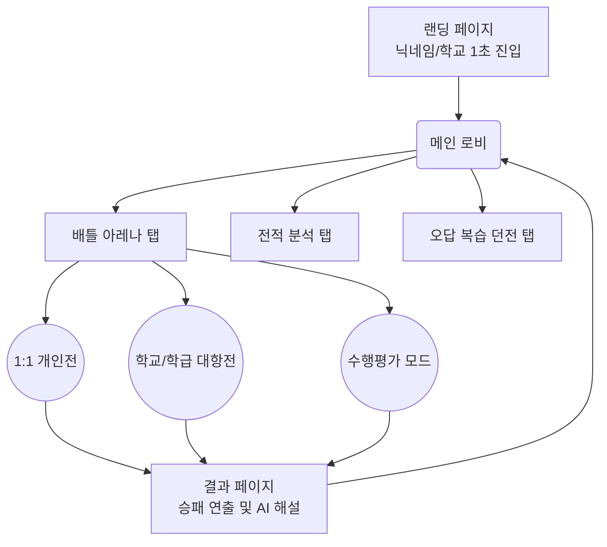
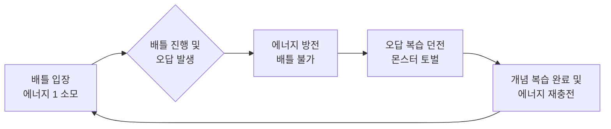
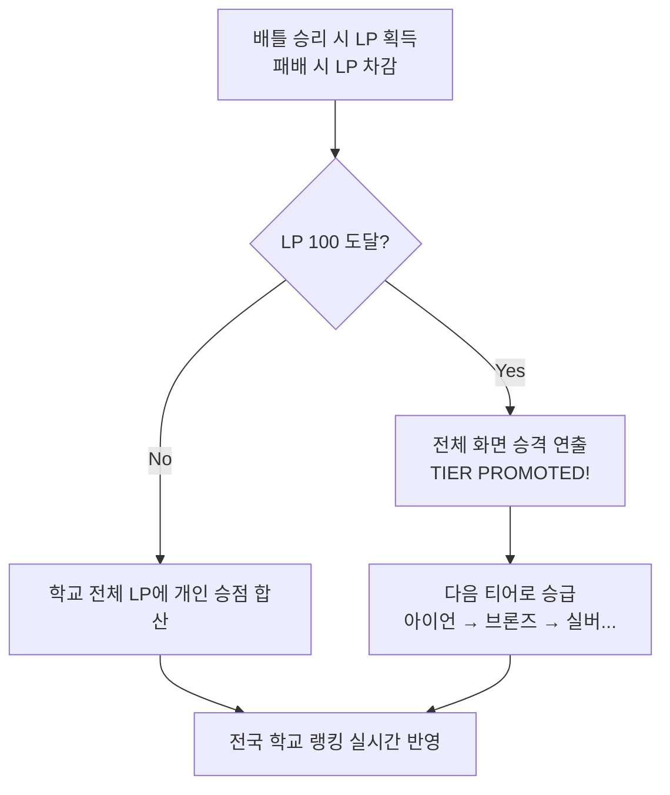
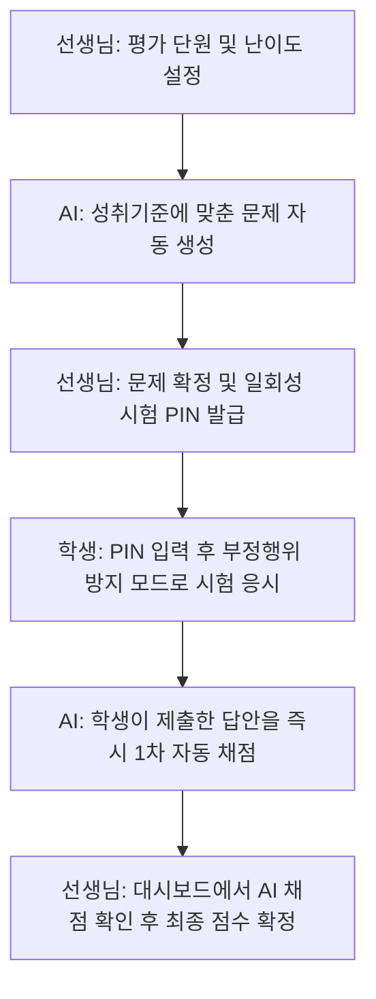

# [디미고 e-비즈니스과 특별전형 실적설명서] 공부를 게임처럼, 실시간 양방향 에듀테크 플랫폼 '배틀스터디'

**지원자:** 청계중학교 3학년 박윤하
**지원 학과:** 한국디지털미디어고등학교 e-비즈니스과

---

## 1. 프로젝트 개요
- **서비스명**: 배틀스터디 (Battle Study)
- **서비스 정의**: 학생의 승부욕(게임의 재미 요소)과 교사의 업무 자동화를 연결한 양방향 에듀테크 웹 플랫폼
- **핵심 슬로건**: "공부를 게임처럼"
- **현재 개발 단계**: 핵심 아이디어를 직접 테스트해 보기 위한 첫 시제품 완성 및 GitHub Pages 실제 배포 완료

## 2. 문제 정의 및 기획 배경 (학생과 선생님의 입장)
학교와 학원을 오가며 문득 이런 생각이 들었습니다. "친구들과 롤(LoL) 랭크 게임을 할 때는 밤을 새우면서, 왜 시험공부와 문제 풀이는 30분 만에 지루해질까?" 그 차이는 바로 '즉각적인 피드백'과 '또래 집단과의 경쟁(보상)'에 있었습니다. 혼자 푸는 문제집은 너무 외롭고 지루했습니다. 
반면 선생님들의 상황은 어떨지 고민해 보았습니다. 학기마다 수백 명의 학생들을 대상으로 수행평가 문제를 출제하고, 일일이 서술형을 채점하며, 학부모님의 채점 기준 이의신청 민원을 방어해야 하는 엄청난 업무 스트레스를 겪고 계셨습니다. 
수업 시간에 가끔 하는 단발성 퀴즈쇼(카훗 등)는 재미있지만 수업이 끝나면 끝이고, 단방향 문제풀이 앱은 지속적인 동기부여가 부족했습니다. 저는 이 둘 사이의 틈새를 찾아, 학생은 방과 후에도 자발적으로 접속해 1:1 라이벌 퀴즈 배틀을 즐기고, 선생님은 교사의 법적 평가권을 보장받으며 공정하고 편리하게 수행평가를 관리할 수 있는 도구가 있다면 어떨까 하는 생각에 '배틀스터디'를 기획하게 되었습니다.

## 3. 예상 사용자 분석
서비스를 명확히 하기 위해 두 가지 핵심 사용자를 설정했습니다.
- **학생 타깃 (중3 박윤하 본인 모델)**: 게임 티어 경쟁에는 열정적이지만 혼자 하는 공부에는 금방 지치는 학생. 학교나 또래 사이에서 자신의 실력을 증명하고 랭킹을 높이며 인정받고 싶은 욕구가 강함.
- **선생님 타깃 (수학과 김선생님)**: 학생들에게 다양한 서술형/과정형 평가를 제공하고 싶지만, 야근을 유발하는 채점과 민원 방어에 치여 결국 객관식 위주의 시험에 의존하게 되는 공교육 현직 선생님들.

## 4. 경쟁사 분석 및 차별화 전략
현재 온라인 교육 시장을 주도하는 메가스터디나 EBS 같은 플랫폼은 훌륭한 강사진을 보유하고 있지만, 결국 '단방향 동영상 강의' 중심이기에 학생 개인의 엄청난 의지력이 필요합니다. 또한 콴다(Qanda)와 같은 문제 풀이 앱은 모르는 문제를 검색할 때만 잠깐 쓰고 끄게 됩니다. 기존 학교에서 쓰이는 카훗(Kahoot) 역시 교사가 수업 시간에 방을 열어주어야만 수동적으로 참여할 수 있었습니다.
배틀스터디는 이들이 가진 '자발적 지속성'의 한계를 다음과 같이 돌파했습니다.
1. **모를 때만 찾는 게 아니라, 이기려고 매일 접속하는 앱**: 방과 후에도 친구나 다른 학교 학생과 1:1로 맞붙고, 우리 학교의 랭킹을 올리기 위해 학생들이 게임을 켜듯 스스로 접속하게 만듭니다. 의지력이 없어도 승부욕을 자극해 매일 접속하게 만드는 장치를 기획했습니다.
2. **공교육 실용성**: 단순한 넌센스나 상식 퀴즈가 아닌, 실제 2022 개정 교육과정 성취기준과 연계된 문항을 제공합니다. 더 나아가, 교사가 주도적으로 AI의 1차 채점을 검토하고 최종 점수를 확정할 수 있는 2단계 채점 시스템을 통해 실제 학교 수행평가에 즉시 도입할 수 있는 실용성을 갖추었습니다.

## 5. 핵심 서비스 로직 및 UI/UX 기획 (게임 요소 & 재방문 유도 설계)

단순한 퀴즈 앱이 되지 않기 위해 게임의 재미 요소를 서비스 로직 깊숙이 설계했습니다.
- **실시간 타임어택 배틀 (1:1 및 단체 대항전)**: 개인전(HP 100)뿐만 아니라 학급 및 학교 간 단체전 모드도 지원합니다. 대항전에서는 팀 전체가 하나의 HP 바를 줄다리기처럼 공유하여 협동심을 자극합니다. 공통적으로 제한 시간의 30% 이내에 정답을 맞히면 '크리티컬 데미지'가 들어가고, 상대가 먼저 풀면 시간이 10초로 단축되는 심리 압박 시뮬레이터를 구현했습니다.
- **강력한 복습 강제 루프 (오답 복습 던전)**: 배틀을 하려면 '번개 에너지'라는 입장권이 필요합니다. 이 에너지를 다 쓰면, 내가 전에 틀렸던 문제들이 몬스터로 등장하는 '오답 복습 던전'을 클리어해야만 에너지가 다시 충전됩니다. 특히 던전을 클리어할 때 단순히 정답만 확인하는 것이 아니라, **마치 e스포츠 코치가 게임 리플레이를 분석해주듯 AI 1:1 튜터가 등장해 내 눈높이에 맞춘 상세한 해설을 제공합니다.** 이를 통해 지루한 오답 노트가 '다음 배틀 승리를 위한 전략 회의'로 변하는 완벽한 복습 인센티브 구조입니다.

- **소속감 기반 입소문 유도 장치 및 점수/승급 체계**: 개인의 승점이 '청계중학교' 전체 LP로 합산되어 전국 학교 랭킹에 반영됩니다. 우리 학교 순위를 방어하기 위해 친구들을 자연스럽게 초대하게 되는 시스템을 기획했습니다. 또한 LP 100점을 돌파하면 화려한 애니메이션과 함께 다음 티어(아이언→브론즈 등)로 승급하여 학생들의 성취감을 극대화합니다.

## 6. 시제품(MVP) 구현 범위
처음부터 모든 기능을 다 만들 수는 없었기에, 가장 먼저 달성하고 싶은 두 가지 핵심 목표를 세우고 이를 테스트할 수 있는 시제품을 기획했습니다.
- **[목표 1. 학생 측면]**: 실시간 게임 경쟁 요소가 학생들의 방과 후 자발적 학습 시간을 정말로 증가시키는지 확인하기
- **[목표 2. 선생님 측면]**: AI 1차 자동 채점이 선생님들의 채점 업무 시간을 획기적으로 단축시킬 수 있는지 확인하기

이 두 가지 목표를 달성하기 위해 다음 5가지 핵심 기능만으로 시제품을 압축했습니다.
1) 1:1 실시간 퀴즈 배틀 아레나
2) 학급/학교 대항전 (단체 줄다리기 체력 공유 모드)
3) 오답 복습 던전 모듈
4) 교사용 일회성 PIN 발급 및 2단계(AI 1차 + 교사 2차 확정) 채점 대시보드

5) 학업 6대 핵심 역량 지표 분석 (게임 전적 검색 스타일의 리포트)

## 7. 생산성 극대화를 위한 AI 보조 도구 활용 전략
이 아이디어를 실제 작동하는 웹 서비스로 구현하는 과정에서, 저는 단순 코딩을 넘어서는 '기획'의 중요성을 깨달았습니다. 저는 AI 에이전트를 페어 개발자로 활용했습니다. 
단순히 "게임을 만들어줘"라고 지시한 것이 아닙니다. 서비스의 상태 머신, 1:1 매칭 로직, 교육과정 성취기준 코드 연계 출제, 교사용 대시보드의 데이터 흐름 등 UI/UX 요구사항을 완벽하게 논리화하여 지시했습니다. 특히 '수행평가 모드'에서는 학생의 닉네임을 블라인드 처리하고 화면 이탈 시 경고 배너를 띄우는 등 실제 학교 시험에 필요한 세부 조건들을 AI에게 구체적으로 설명하고 그대로 구현하도록 지시했습니다. 이를 통해 1인 기획자임에도 단기간에 실제 시연과 가설 검증이 가능한 수준의 완성도 높은 웹 애플리케이션 프로토타입을 구축할 수 있었습니다.

## 8. MVP 시연 및 테스트 결과
완성된 배틀스터디는 브라우저만으로 즉시 시연 가능한 완결형 데모로 구축하여 GitHub Pages에 실배포를 완료했습니다.
- **학생 화면**: LoL과 유사한 어두운 다크 테마를 적용해 몰입감을 높이고, 실시간 1:1 배틀 및 단체 줄다리기 대항전, 오답 복습 던전의 동적인 효과를 강조했습니다. 또한 게임 전적 검색 스타일의 분석 탭을 자체 구현하여, 나의 학업 6대 핵심 역량(개념 이해, 문제 해결 등)을 학교 및 전국 평균과 실시간 비교하는 정육각형 레이더 차트를 구축했습니다.
- **교사 화면**: 이와 대조적으로 단정하고 신뢰감 있는 화이트 테마를 적용하여, AI 출제 -> 일회성 PIN 발급 -> 실시간 제출 모니터링 -> 2단계 점수 확정으로 이어지는 수학 수행평가 전용 4단계 대시보드 UI를 시각적으로 명확하게 구현해 냈습니다.

## 9. 사용자 피드백 분석 및 기획 개선
프로토타입을 테스트하며 다양한 피드백을 수집하고, 이를 바탕으로 기획을 개선했습니다.
- **학생 피드백**: "상대방이 먼저 풀어서 시간이 10초로 확 줄어들 때 정말 심장이 쫄렸다", "게임을 계속 하려고 오답 복습 던전에서 몬스터를 잡다 보니 저절로 공식이 외워졌다"는 긍정적인 반응을 얻으며 복습 루프 기획이 적중했음을 확인했습니다.
- **교사 피드백 기반 시스템 보완**: 현직 선생님들의 시각에서는 교실에서 학생들이 PIN 코드를 공유하거나 담합할 위험성이 지적되었습니다. 저는 이 피드백을 즉시 수용하여, 시험 종료와 동시에 코드가 영구 만료되는 '일회성 PIN 라이프사이클'을 도입했습니다. 또한 배틀 모드의 화려한 게임 효과를 끈 '수행평가 모드(흰색 시험지 테마)'를 긴급 추가하여, 실제 학교 현장에서도 평가의 신뢰도를 보장할 수 있도록 시스템을 보완했습니다.

## 10. 향후 비즈니스 확장 및 발전 계획
단순히 한 번 만들어보고 끝나는 일회성 프로젝트가 아니라, 실제로 수많은 학생들이 일상적으로 꾸준히 이용하는 진짜 서비스로 키워갈 방법도 깊이 고민했습니다.
- **1단계 (B2B 지역 학원 제휴)**: 서비스 초기에는 지역 학원가와 제휴하여, '이번 주 OO고 vs XX고 대항전' 같은 이벤트를 열고 학원의 배너 노출 및 상품 협찬을 받는 방식으로 시작합니다.
- **2단계 (B2C 프리미엄 구독)**: 단방향 인강(VOD)을 완전히 대체할 '초개인화 AI 밀착 과외'를 월 구독 모델로 제공합니다. 학생의 전적 데이터(6대 역량 지표)를 분석해, 배틀에서 틀린 문제의 원인이 되는 취약 선행 개념까지 거슬러 올라가 대치동 과외 선생님 이상으로 집요하게 설명해 주는 프리미엄 AI 오답 클리닉으로 수익을 창출합니다.
- **3단계 (B2G 학교 단위 도입)**: 최종적으로는 공교육 학교 단위로 계약하여, 선생님들의 수행평가 성적 관리를 돕는 B2G 교육용 서비스로 확장하는 것이 목표입니다.

## 11. 프로젝트 인사이트 및 디미고 e-비즈니스과 진학 동기
이번 프로젝트를 진행하며 저는 AI를 통해 누구나 아이디어를 쉽게 웹 서비스로 구현할 수 있는 시대일수록, 결국 서비스의 성패를 가르는 것은 **'사용자가 진짜로 불편해하는 점을 날카롭게 찾아내고, 이를 해결할 방법과 계속 이용하게 만들 재미 요소를 논리적으로 설계하는 기획력'**이라는 것을 깊이 체감했습니다.
현재 가설 검증 단계인 배틀스터디 MVP를 실제로 많은 학생들이 사용하는 정식 서비스로 키우기 위해서는 체계적인 경영, 마케팅, 빅데이터 융합 지식이 반드시 필요합니다. 제가 한국디지털미디어고등학교 e-비즈니스과에 지원하는 이유입니다. 저는 디미고의 교육 과정 안에서 기획과 비즈니스 지식을 체계적으로 배워, 장차 메가스터디를 뛰어넘어 대한민국 학생들의 학습 방식을 '게임처럼' 완전히 혁신하는 차세대 에듀테크 서비스 기획자로 성장하겠습니다.
