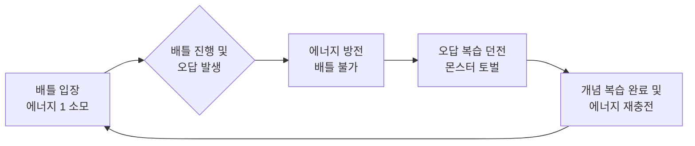
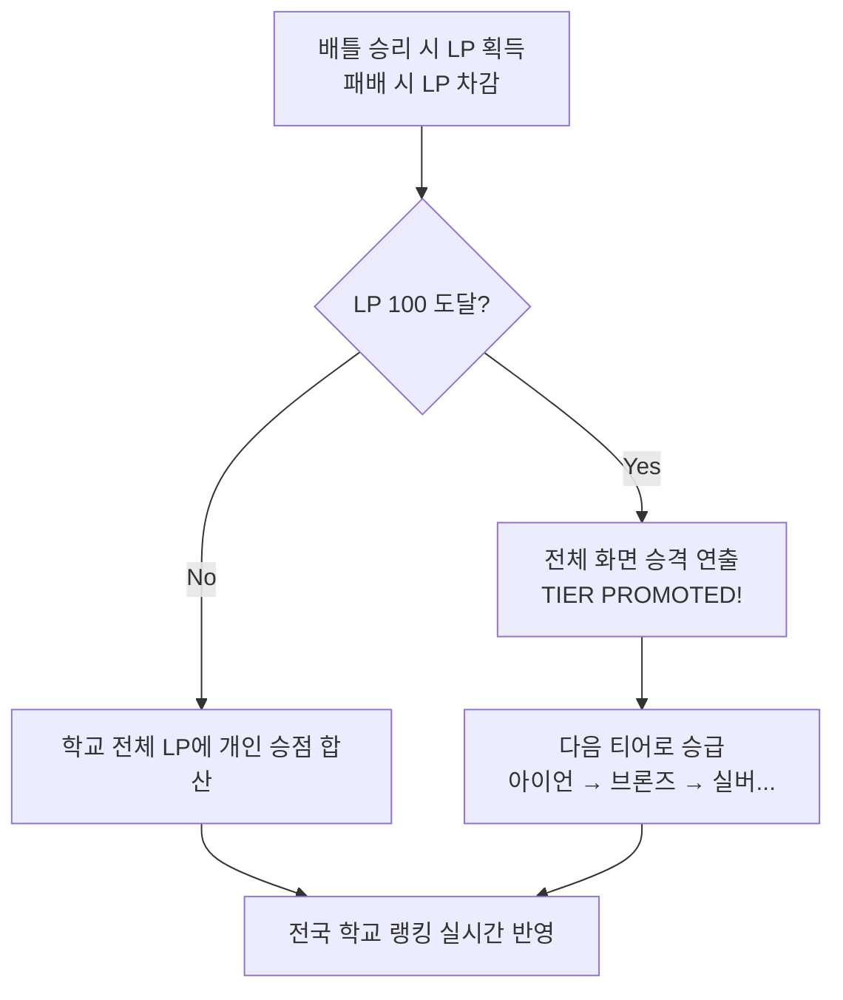
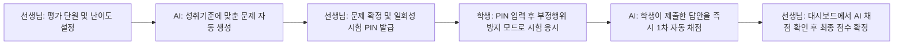

# [디미고 e-비즈니스과 특별전형 실적설명서] 공부를 게임처럼, 실시간 양방향 에듀테크 플랫폼 '배틀스터디'

**지원자:** 청계중학교 3학년 박윤하
**지원 학과:** 한국디지털미디어고등학교 e-비즈니스과

---

## 1. 프로젝트 개요
- **서비스명**: 배틀스터디 (Battle Study)
- **서비스 정의**: 학생의 승부욕(게임의 재미 요소)과 교사의 업무 자동화를 연결한 양방향 에듀테크 웹 플랫폼
- **핵심 슬로건**: "공부를 게임처럼"
- **현재 개발 단계**: 핵심 아이디어를 직접 테스트해 보기 위한 첫 시제품 완성 및 GitHub Pages 실제 배포 완료

## 2. 문제 정의 및 기획 배경
학교와 학원을 오가며 문득 이런 생각이 들었습니다. "친구들과 롤(LoL) 랭크 게임을 할 때는 밤을 새우면서, 왜 시험공부와 문제 풀이는 30분 만에 지루해질까?" 그 차이는 바로 **'즉각적인 피드백'**과 **'또래 집단과의 경쟁(보상)'**에 있었습니다. 혼자 푸는 문제집은 너무 외롭고 지루한 데다, 모르는 문제를 1:1로 짚어주는 학원이나 과외는 부모님께 큰 **사교육비 부담**을 드려 항상 마음에 걸렸습니다.
반면 선생님들의 상황은 어떨지 고민해 보았습니다. 학기마다 수백 명의 학생들을 대상으로 수행평가 문제를 직접 출제하고, 학생들의 서술형 답안을 일일이 **수작업으로 채점하고 점수를 관리**해야 하는 엄청난 업무 스트레스를 겪고 계셨습니다. 
수업 시간에 가끔 하는 단발성 퀴즈쇼(카훗 등)는 재미있지만 수업이 끝나면 끝이고, 단방향 문제풀이 앱은 지속적인 동기부여가 부족했습니다. 저는 이 틈새를 찾아, 학생은 **비싼 사교육 없이도 자발적으로 1:1 퀴즈 배틀과 AI 밀착 과외**를 즐기고, 선생님은 **교사의 법적 평가권을 보장받으며 공정하고 편리하게 수행평가를 관리**할 수 있는 도구가 있다면 어떨까 하는 생각에 '배틀스터디'를 기획하게 되었습니다.

## 3. 예상 사용자 분석
서비스를 명확히 하기 위해 두 가지 핵심 사용자를 설정했습니다.
- **학생 타깃 (본인)**: 게임 티어 경쟁에는 열정적이지만 혼자 하는 공부에는 금방 지치는 학생. 학교나 또래 사이에서 **자신의 실력을 증명하고 랭킹을 높이며 인정받고 싶은 욕구**가 강함.
- **선생님 타깃 (수학선생님)**: 학생들에게 다양한 서술형/과정형 평가를 제공하고 싶지만, **수백 명 분의 과도한 수작업 채점 업무에 치여 결국 객관식 위주의 시험에 의존**하게 되는 공교육 현직 선생님들.

## 4. 기존 사교육의 한계 분석 및 차별화 전략
현재 대부분의 학생들은 모르는 문제를 1:1로 질문하고 맞춤 관리를 받기 위해 비싼 학원이나 고액 과외에 크게 의존하고 있습니다. 메가스터디나 EBS 같은 온라인 플랫폼이 존재하지만, 결국 **'단방향 동영상 강의'** 중심이기에 학원만큼 밀착 관리가 되지 않아 학생 개인의 엄청난 의지력이 필요합니다. 
배틀스터디는 막대한 비용이 드는 사교육 의존도와 기존 단방향 교육의 한계를 다음과 같이 돌파했습니다.
1. **비싼 학원 대신, 스스로 매일 접속하는 앱**: 억지로 학원에 끌려가는 것이 아니라, 방과 후에도 친구들과 1:1로 맞붙고 우리 학교의 랭킹을 올리기 위해 게임을 켜듯 스스로 접속하게 만듭니다. **의지력이 없어도 승부욕을 자극해 매일 공부하게 만드는 장치**를 기획했습니다.
2. **고액 과외를 대체하는 AI 밀착 튜터링**: 배틀에서 틀린 문제는 '오답 던전'에서 AI가 학생의 수준을 분석해 대치동 1타 강사처럼 1:1로 짚어줍니다. 값비싼 과외를 받지 않아도 언제든 최고 수준의 피드백을 받을 수 있습니다.
3. **공교육 내실화 지원**: 실제 **2022 개정 교육과정 성취기준과 연계된 문항**과 선생님들이 주도적으로 채점할 수 있는 **2단계 채점 시스템**을 제공하여, 사교육 없이도 학교 수업과 수행평가만으로 충분한 학습이 가능하도록 공교육 현장을 지원합니다.

## 5. 핵심 서비스 로직 및 UI/UX 기획 (게임 요소 & 재방문 유도 설계)

```mermaid
graph TD
    A[진입(시작) 페이지<br>닉네임/학교 1초 진입] --> B(메인 로비)
    B --> C[배틀 아레나 탭]
    B --> D[전적 분석 탭]
    B --> E[오답 복습 던전 탭]
    C --> F((1:1 개인전))
    C --> G((학교/학급 대항전))
    C --> H((수행평가 모드))
    F & G & H --> I[결과 페이지<br>승패 연출 및 AI 해설]
    I --> B
```

단순한 퀴즈 앱이 되지 않기 위해 게임의 재미 요소를 서비스 로직 깊숙이 설계했습니다.
- **실시간 타임어택 배틀 (1:1 및 단체 대항전)**: 개인전(HP, Health Point 100)뿐만 아니라 학급 및 학교 간 단체전 모드도 지원합니다. 대항전에서는 팀 전체가 하나의 HP 바를 줄다리기처럼 공유하여 협동심을 자극합니다. 공통적으로 제한 시간의 30% 이내에 정답을 맞히면 '크리티컬 데미지'가 들어가고, 상대가 먼저 풀면 시간이 10초로 단축되는 심리 압박 시뮬레이터를 구현했습니다.
- **강력한 복습 강제 루프 (오답 복습 던전)**: 배틀을 하려면 '번개 에너지'라는 입장권이 필요합니다. 이 에너지를 다 쓰면, 내가 전에 틀렸던 문제들이 몬스터로 등장하는 '오답 복습 던전'을 클리어해야만 에너지가 다시 충전됩니다. 특히 던전을 클리어할 때 단순히 정답만 확인하는 것이 아니라, **마치 대치동 1타 과외 선생님이 내 약점을 짚어주듯 AI 1:1 튜터가 내 눈높이에 맞춘 상세한 해설을 제공합니다.** 이를 통해 지루한 오답 노트가 '다음 배틀 승리를 위한 전략 회의'로 변하는 완벽한 복습 인센티브 구조입니다.


- **소속감 기반 입소문 유도 장치 및 점수/승급 체계**: 개인의 승점이 '청계중학교' 전체 LP(League Point)로 합산되어 전국 학교 랭킹에 반영됩니다. 우리 학교 순위를 방어하기 위해 친구들을 자연스럽게 초대하게 되는 시스템을 기획했습니다. 또한 LP 100점을 돌파하면 화려한 애니메이션과 함께 다음 티어(아이언→브론즈 등)로 승급하여 학생들의 성취감을 극대화합니다.



## 6. 시제품(MVP) 구현 범위
처음부터 모든 기능을 다 만들 수는 없었기에, 가장 먼저 달성하고 싶은 두 가지 핵심 목표를 세우고 시제품을 기획했습니다.
- **[목표 1. 학생 측면]**: 실시간 게임 경쟁 요소를 도입하여 **학생들의 자발적인 문제 풀이 시간 극대화**
- **[목표 2. 선생님 측면]**: AI 문제 자동 생성과 1차 자동 채점을 함께 도입하여, **교사의 수행평가 출제 및 채점 행정 업무 부담을 획기적으로 경감**

이 두 가지 목표를 달성하기 위해 다음 5가지 핵심 기능만으로 시제품을 압축했습니다.
1) 1:1 실시간 퀴즈 배틀 아레나
2) 학급/학교 대항전 (단체 줄다리기 체력 공유 모드)
3) 오답 복습 던전 모듈
4) 교사용 수행평가 통합 대시보드

5) 학업 6대 핵심 역량 지표 분석 (게임 전적 검색 스타일의 리포트)

## 7. 기획은 내가, 코딩은 AI가: 1인 개발 과정의 어려움 극복
학생과 선생님의 고통을 덜어주겠다는 목표는 뚜렷했지만, 대규모 웹 서비스를 직접 만들어 본 적이 없어 처음에는 눈앞이 캄캄했습니다. 하지만 1인 기획자로서의 한계를 극복하기 위해 다음과 같은 노력으로 난관을 돌파했습니다.

- **난관 1: 처음 해보는 웹 서비스 기획의 막막함**
  큰 규모의 웹 서비스를 처음 만들어보다 보니 어디서부터 시작해야 할지 몰라 눈앞이 캄캄했습니다.
- **극복 1: 미니 게임(ddino) 연습과 다방면의 학습을 통한 기초 쌓기**
  처음부터 어려운 배틀스터디에 뛰어들지 않고, 먼저 간단한 미니 게임(ddino)을 만들어보며 기초를 다졌습니다. 또한 『2025 비즈니스 모델』, 『10대가 프로그래머가 되기 위한 방법』 등의 책을 읽으며 IT 서비스와 비즈니스의 큰 그림을 익혔고, 유튜브와 IT 블로그 등을 적극적으로 찾아보며 'AI에게 똑똑하게 질문하고 코드를 뽑아내는 실전 프롬프트 활용법'을 따로 공부했습니다.

- **난관 2: 'AI가 알아서 해주겠지'라는 생각과 꼬여버린 코드**
  본격적으로 개발을 시작했을 때, '대충 말해도 AI가 다 알아서 코드를 짜주겠지'라고 생각했습니다. 하지만 복잡한 게임 규칙을 단순하게 지시하니 AI가 자꾸 엉뚱한 코드를 만들었습니다. 에러가 날 때마다 대충 고쳐달라고 하다 보니, 어느새 코드가 여기저기 꼬여서 손쓸 수 없는 상태가 되었습니다.
- **극복 2: 꼼꼼한 기획과 AI를 활용한 주기적인 코드 정리**
  이 일을 겪고 나서, 무작정 지시하기 전에 **'제가 먼저 구체적인 작동 규칙을 세워야 한다'**는 것을 깨달았습니다. 이후에는 종이에 1:1 매칭 규칙 등을 꼼꼼히 적어둔 뒤에만 AI에게 코드를 짜달라고 했습니다. 또한, 코드가 복잡하게 꼬일 때마다 AI에게 전체 구조를 다시 정리해 달라고 지시하여 불필요한 중복을 덜어냈습니다. 이처럼 코드를 깔끔하게 유지해야만 서비스가 안정적으로 돌아갈 뿐만 아니라, 다음에 내리는 새로운 지시도 AI가 제가 의도한 대로 잘 알아듣고 코드를 짜준다는 것을 확실히 배웠습니다.

- **난관 3: 깃허브(GitHub)에 올리는 과정의 어려움**
  완성된 게임을 친구들에게 보여주기 위해 깃허브에 올려야 했지만, 애초에 깃허브라는 개념 자체를 이해하는 것조차 어려웠고, 처음 보는 까만 화면(터미널)의 `commit`, `push` 같은 명령어들은 너무 복잡했습니다.
- **극복 3: 몸이 기억할 때까지 무한 반복하기**
  미니 게임(ddino) 코드를 무작정 올려보는 연습부터 시작해, 깃허브의 기본 원리와 명령어의 뜻을 하나씩 검색하며 부딪혀갔습니다. 한 번 성공하고 끝낸 것이 아니라, 배틀스터디에 새로운 기능이 추가될 때마다 어떤 상황에서 어떤 명령어를 쳐야 하는지 손에 익을 때까지 수십 번씩 반복하며 연습했습니다. 그 결과, 이제는 까만 터미널 화면이 두렵지 않게 되었고, 스스로 프로젝트를 깃허브에 올리고 업데이트하는 기본기를 확실하게 다질 수 있었습니다.

## 8. MVP 시연 및 사용자 피드백 기반 기획 개선 (버전 업데이트 이력)
완성된 배틀스터디 데모를 GitHub Pages에 배포한 후, 실제 타깃인 학생 친구들과 학교 선생님들께 시연하며 살아있는 피드백을 수집하고 50여 회 이상의 커밋을 거쳐 서비스를 발전시켰습니다.

- **🚀 v1.0: 핵심 기능 테스트 및 최초 시연**
  1:1 퀴즈 배틀 아레나(학생용 다크 테마) 및 단체 줄다리기 대항전, 그리고 교사-학생 수행평가 흐름(교사용 화이트 테마 대시보드)을 최초 완성하여 주변에 시연했습니다.
  
- **🚀 v1.1: 학생 피드백 기반 '전적 분석(Analytics)' 신설**
  대항전을 시연했을 때 친구들이 크게 열광했지만, "배틀 자체는 재밌는데 내가 어느 부분이 부족한지 진짜 실력 수치를 한눈에 보고 싶다"는 피드백이 있었습니다. 이를 반영하여 유명 게임 전적 검색 사이트(OP.GG) 스타일의 전적 분석 탭을 신설하고, 학생 개인의 6대 학업 역량을 방사형 차트로 시각화하여 경쟁심을 학업으로 연결했습니다.

- **🚀 v1.2: 교사 피드백 기반 '부정행위 완벽 차단' 로직 도입**
  수학 수행평가 대시보드를 보신 선생님들께서 업무 경감에 공감하시면서도 "스마트폰으로 시험을 보면 몰래 다른 창을 띄워 답을 검색할 수 있다"며 평가 공정성을 걱정하셨습니다. 이에 현장의 우려를 불식시키기 위해, 수행평가 도중 화면을 이탈(다른 인터넷 창 이동 등)하면 상단에 붉은 경고 배너가 뜨며 즉시 0점(실격) 처리되는 감지 기능을 추가하여 공교육 현장에서 100% 믿고 쓸 수 있는 시스템을 완성했습니다.

- **🚀 v1.3: 공통 피드백 기반 'AI 과외 튜터링' 고도화**
  오답 복습 던전에서 단순히 정답만 확인하는 것은 기존 학습 앱과 다를 바 없다는 의견에 따라 AI의 피드백 방식을 전면 개편했습니다. AI가 단순히 답을 알려주는 것을 넘어, 마치 대치동 1타 과외 선생님처럼 학생 눈높이에 맞춰 취약점을 짚어주며 상세한 해설을 제공하도록 시스템을 정교하게 다듬었습니다.

## 9. 향후 비즈니스 확장 및 발전 계획
단순히 한 번 만들어보고 끝나는 일회성 프로젝트가 아니라, 실제로 수많은 학생들이 일상적으로 꾸준히 이용하는 진짜 서비스로 키워갈 방법도 깊이 고민했습니다.
- **1단계 (B2B 지역 학원 제휴)**: 서비스 초기에는 지역 학원가와 제휴하여, '이번 주 OO고 vs XX고 대항전' 같은 이벤트를 열고 학원의 배너 노출 및 상품 협찬을 받는 방식으로 시작합니다.
- **2단계 (B2C 프리미엄 구독)**: 단방향 인강(VOD)을 완전히 대체할 '초개인화 AI 밀착 과외'를 월 구독 모델로 제공합니다. 학생의 전적 데이터(6대 역량 지표)를 분석해 취약 개념을 집요하게 설명해 주는 프리미엄 AI 오답 클리닉을 **기존 학원이나 과외 비용의 10분의 1도 안 되는 비용으로 제공하여, 사교육비 부담을 획기적으로 줄이면서도 안정적인 수익을 창출**합니다.
- **3단계 (B2G 공교육 도입)**: 최종적으로는 공교육 학교 단위로 계약하여, 선생님들의 수행평가 성적 관리를 돕는 B2G 교육용 서비스로 확장하는 것이 목표입니다.

## 10. 마치며: '배틀스터디'가 내게 가르쳐준 것들
이번 프로젝트를 진행하며 저는 AI를 통해 누구나 아이디어를 쉽게 웹 서비스로 구현할 수 있는 시대일수록, 결국 서비스의 성패를 가르는 것은 **'사용자가 진짜로 불편해하는 점을 날카롭게 찾아내고, 이를 해결할 방법과 계속 이용하게 만들 재미 요소를 논리적으로 설계하는 기획력'**이라는 것을 깊이 체감했습니다.
현재 가설 검증 단계인 배틀스터디 MVP를 실제로 많은 학생들이 사용하는 정식 서비스로 키우기 위해서는 체계적인 경영, 마케팅, 빅데이터 융합 지식이 반드시 필요합니다. 제가 한국디지털미디어고등학교 e-비즈니스과에 지원하는 이유입니다. 저는 디미고의 교육 과정 안에서 기획과 비즈니스 지식을 체계적으로 배워, 장차 메가스터디를 뛰어넘어 **사교육비로 인한 교육 격차를 해소하고**, 대한민국 학생들의 학습 방식을 '게임처럼' 완전히 혁신하는 차세대 에듀테크 서비스 기획자로 성장하겠습니다.
